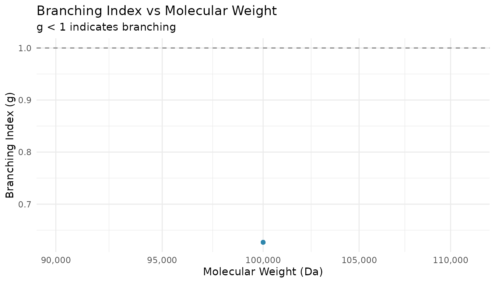
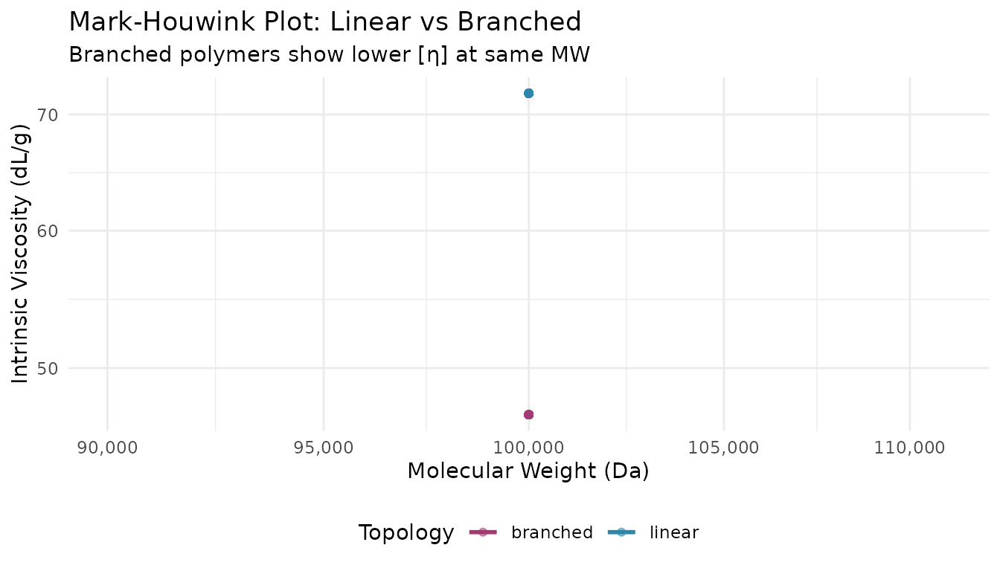
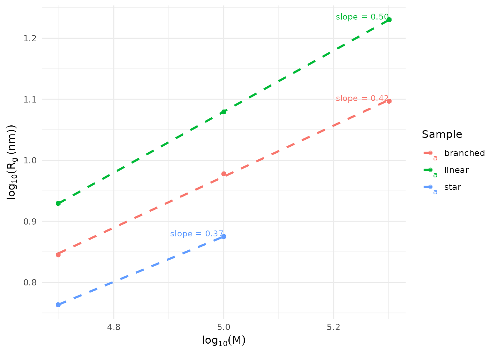

# Polymer Branching Analysis

## Overview

> The branching calculations in this vignette use supplied
> molecular-weight and radius-of-gyration values. The current
> [`step_sec_mals()`](https://jameshwade.github.io/measure.sec/reference/step_sec_mals.md)
> implementation does not fit multi-angle data or calculate radius of
> gyration.

This guide shows how to analyze polymer branching using multi-detector
SEC data. You’ll learn to:

1.  Calculate branching indices (g and g’)
2.  Estimate branching frequency
3.  Analyze Mark-Houwink parameters
4.  Compare branching architectures
5.  Visualize conformation data

## Setup

``` r

library(measure)
#> Loading required package: recipes
#> Loading required package: dplyr
#> 
#> Attaching package: 'dplyr'
#> The following objects are masked from 'package:stats':
#> 
#>     filter, lag
#> The following objects are masked from 'package:base':
#> 
#>     intersect, setdiff, setequal, union
#> 
#> Attaching package: 'recipes'
#> The following object is masked from 'package:stats':
#> 
#>     step
library(measure.sec)
library(dplyr)
library(ggplot2)
```

## When You Need Branching Analysis

Branching affects polymer properties like:

- **Melt viscosity**: Branched polymers often have lower viscosity than
  linear analogs
- **Mechanical strength**: Long-chain branching can improve toughness
- **Solution behavior**: Branched chains are more compact than linear
  ones

SEC with MALS and viscometry detectors can quantify branching by
comparing branched samples to linear references of the same molecular
weight.

## Example Data

The package includes `sec_branched`, a dataset with linear, branched,
and star polymers:

``` r

data(sec_branched)

# Sample overview
sec_branched |>
  distinct(sample_id, topology) |>
  print()
#> # A tibble: 8 × 2
#>   sample_id   topology
#>   <chr>       <chr>   
#> 1 Linear-50K  linear  
#> 2 Linear-100K linear  
#> 3 Linear-200K linear  
#> 4 Branch-50K  branched
#> 5 Branch-100K branched
#> 6 Branch-200K branched
#> 7 Star-50K    star    
#> 8 Star-100K   star

# Preview the data structure
sec_branched |>
  group_by(sample_id) |>
  summarize(
    mw_range = paste(round(min(mw)), "-", round(max(mw))),
    mean_g = round(mean(branching_index, na.rm = TRUE), 3),
    .groups = "drop"
  )
#> # A tibble: 8 × 3
#>   sample_id   mw_range      mean_g
#>   <chr>       <chr>          <dbl>
#> 1 Branch-100K 1e+05 - 1e+05   0.65
#> 2 Branch-200K 2e+05 - 2e+05   0.55
#> 3 Branch-50K  50000 - 50000   0.75
#> 4 Linear-100K 1e+05 - 1e+05   1   
#> 5 Linear-200K 2e+05 - 2e+05   1   
#> 6 Linear-50K  50000 - 50000   1   
#> 7 Star-100K   1e+05 - 1e+05   0.5 
#> 8 Star-50K    50000 - 50000   0.6
```

## Calculating Branching Index (g)

The branching index **g** compares the radius of gyration of a branched
polymer to a linear reference at the same molecular weight:

``` math
g = \frac{R_g^2(\text{branched})}{R_g^2(\text{linear})}
```

Values of g \< 1 indicate branching (branched chains are more compact).

### Using Linear Reference Data

``` r

# Extract linear and branched samples
linear_ref <- sec_branched |>
  filter(topology == "linear") |>
  select(mw, rg)

branched_sample <- sec_branched |>
  filter(sample_id == "Branch-100K")

# Calculate g ratio using linear reference
g_result <- measure_branching_index(

  mw = branched_sample$mw,
  rg = branched_sample$rg,
  reference = linear_ref,
  method = "g"
)
#> Warning in regularize.values(x, y, ties, missing(ties), na.rm = na.rm):
#> collapsing to unique 'x' values

print(g_result)
#> Branching Analysis Results
#> ================================================== 
#> 
#> MW Range: 100000 - 100000
#> g (Rg ratio): 0.627 - 0.627 (mean: 0.627)
#> 
#> Estimated branches/molecule: 2.6 - 2.6
#> 
#> # A tibble: 701 × 2
#>        mw     g
#>     <dbl> <dbl>
#>  1 100000 0.627
#>  2 100000 0.627
#>  3 100000 0.627
#>  4 100000 0.627
#>  5 100000 0.627
#>  6 100000 0.627
#>  7 100000 0.627
#>  8 100000 0.627
#>  9 100000 0.627
#> 10 100000 0.627
#> # ℹ 691 more rows
```

### Interpreting g Values

| g Value | Interpretation                        |
|---------|---------------------------------------|
| 1.0     | Linear polymer                        |
| 0.7-0.9 | Lightly branched                      |
| 0.4-0.7 | Moderately branched                   |
| \< 0.4  | Highly branched (star, hyperbranched) |

``` r

# Visualize g across MW distribution
branched_with_g <- branched_sample |>
  mutate(g = g_result$g)

ggplot(branched_with_g, aes(x = mw, y = g)) +

geom_point(alpha = 0.5, color = "#2E86AB") +
  geom_hline(yintercept = 1, linetype = "dashed", color = "gray50") +
  scale_x_log10(labels = scales::label_comma()) +
  labs(
    x = "Molecular Weight (Da)",
    y = "Branching Index (g)",
    title = "Branching Index vs Molecular Weight",
    subtitle = "g < 1 indicates branching"
  ) +
  theme_minimal()
```



## Estimating Branching Frequency

The branching frequency (branches per molecule) can be estimated from g
using Zimm-Stockmayer theory:

``` r

# Calculate branching frequency assuming random branching
freq <- measure_branching_frequency(
  g = g_result$g,
  architecture = "random",
  mw = branched_sample$mw
)

print(freq)
#> Branching Frequency Analysis (Zimm-Stockmayer)
#> ================================================== 
#> 
#> Architecture: random
#> N samples: 701
#> 
#> g ratio range: 0.627 - 0.627
#> Branches/molecule: 7.74 - 7.74 (mean: 7.74)
#> Branch density: 0.0774 - 0.0774 per 1000 Da
#> 
#> # A tibble: 701 × 2
#>        g branches_per_molecule
#>    <dbl>                 <dbl>
#>  1 0.627                  7.74
#>  2 0.627                  7.74
#>  3 0.627                  7.74
#>  4 0.627                  7.74
#>  5 0.627                  7.74
#>  6 0.627                  7.74
#>  7 0.627                  7.74
#>  8 0.627                  7.74
#>  9 0.627                  7.74
#> 10 0.627                  7.74
#> # ℹ 691 more rows
```

### Different Architectures

The relationship between g and branching frequency depends on polymer
architecture:

``` r

# Compare architectures for the same g value
g_test <- 0.6

architectures <- c("random", "star_3", "star_4", "comb")
results <- sapply(architectures, function(arch) {
  tryCatch(
    measure_branching_frequency(g = g_test, architecture = arch)$branches_per_molecule,
    error = function(e) NA
  )
})

data.frame(
  Architecture = architectures,
  Branches = round(results, 2)
)
#>        Architecture Branches
#> random       random     8.96
#> star_3       star_3     1.00
#> star_4       star_4     1.00
#> comb           comb     1.00
```

## Mark-Houwink Analysis

Mark-Houwink parameters (K and α) describe the relationship between
intrinsic viscosity and molecular weight:

``` math
[\eta] = K \cdot M^\alpha
```

The exponent α provides conformational information:

| α Value | Conformation                 |
|---------|------------------------------|
| 0.5     | Theta solvent (random coil)  |
| 0.6-0.8 | Good solvent (expanded coil) |
| \> 0.8  | Rod-like                     |
| \< 0.5  | Branched/compact             |

``` r

# Extract MW and intrinsic viscosity data
linear_data <- sec_branched |>
  filter(topology == "linear", !is.na(intrinsic_visc), intrinsic_visc > 0)

# Calculate Mark-Houwink parameters
mh <- measure_mh_parameters(
  mw = linear_data$mw,
  intrinsic_visc = linear_data$intrinsic_visc
)

print(mh)
#> Mark-Houwink Parameters
#> ======================================== 
#> 
#> K = 2.9716e-02
#> a = 0.677
#> 
#> R-squared: 1.0000
#> Data points: 2103
#> MW range: 50000 - 200000
#> 
#> Equation: [eta] = K * M^a
```

### Comparing Linear vs Branched

``` r

# Compare Mark-Houwink plots
comparison_data <- sec_branched |>
  filter(!is.na(intrinsic_visc), intrinsic_visc > 0) |>
  filter(sample_id %in% c("Linear-100K", "Branch-100K"))

ggplot(comparison_data, aes(x = mw, y = intrinsic_visc, color = topology)) +
  geom_point(alpha = 0.5) +
  geom_smooth(method = "lm", se = FALSE, linewidth = 1) +
  scale_x_log10(labels = scales::label_comma()) +
  scale_y_log10() +
  scale_color_manual(values = c("linear" = "#2E86AB", "branched" = "#A23B72")) +
  labs(
    x = "Molecular Weight (Da)",
    y = "Intrinsic Viscosity (dL/g)",
    color = "Topology",
    title = "Mark-Houwink Plot: Linear vs Branched",
    subtitle = "Branched polymers show lower [η] at same MW"
  ) +
  theme_minimal() +
  theme(legend.position = "bottom")
#> `geom_smooth()` using formula = 'y ~ x'
```



## Rg-MW Scaling Analysis

The relationship between radius of gyration and molecular weight
follows:

``` math
R_g = K_{Rg} \cdot M^\nu
```

The exponent ν provides conformational information similar to α.

``` r

# Calculate Rg-MW scaling parameters
rg_scaling <- measure_rg_mw_scaling(
  mw = linear_data$mw,
  rg = linear_data$rg
)

print(rg_scaling)
#> Rg-MW Scaling Analysis
#> ======================================== 
#> 
#> Scaling Law: Rg = K * M^nu
#> 
#> nu (Flory exponent): 0.500
#>   95% CI: [0.500, 0.500]
#> K (prefactor): 3.7991e-02
#> 
#> Conformation: theta solvent (ideal chain)
#> 
#> R-squared: 1.0000
#> Data points: 2103
#> MW range: 50000 - 200000
```

## Comparing Branching Models

When you have experimental g data, you can compare it against
theoretical predictions to identify the most likely branching
architecture:

``` r

# Compare experimental data to branching models
branched_data <- sec_branched |>
  filter(topology == "branched", !is.na(branching_index))

comparison <- measure_branching_model_comparison(
  g = branched_data$branching_index,
  mw = branched_data$mw
)

print(comparison)
#> Branching Model Comparison
#> ============================================================ 
#> 
#> Model Fit Summary:
#> ------------------------------------------------------------ 
#>          model   parameter r_squared       rmse        aic
#>         random 0.066439282 0.9545604 0.01740491 -11066.463
#>           star 1.657330898 0.6361160 0.04925336  -6691.276
#>           comb 0.007454604 0.7363526 0.04192433  -7368.910
#>  hyperbranched 0.132485444 0.9303057 0.02155524 -10166.940
#> ------------------------------------------------------------ 
#> 
#> Best Model: random (lowest AIC)
#>   R-squared: 0.9546
#>   RMSE: 0.0174
#>   Parameter: 0.0664
#> 
#> Note: Lower AIC indicates better fit with penalty for complexity.
#> Consider physical plausibility when selecting the final model.
```

## Conformation Plots

Visualize structure-MW relationships with
[`plot_sec_conformation()`](https://jameshwade.github.io/measure.sec/reference/plot_sec_conformation.md).
The slope reveals polymer conformation:

``` r

# Prepare data for conformation plot
plot_data <- sec_branched |>
  filter(!is.na(rg), rg > 0, !is.na(mw), mw > 0)

# Create Rg-MW conformation plot
plot_sec_conformation(
  plot_data,
  type = "rg_mw",
  mw_col = "mw",
  y_col = "rg",
  sample_id = "topology",
  show_fit = TRUE,
  show_exponent = TRUE
)
```



The slope (ν) indicates conformation: - **ν ≈ 0.5-0.6**: Linear chains
in good solvent - **ν \< 0.5**: Branched or compact structures - **ν \>
0.6**: Extended chains

## Complete Workflow Example

Here’s a complete workflow for analyzing an unknown branched sample:

``` r

# Step 1: Load and prepare data
unknown_sample <- sec_branched |>
  filter(sample_id == "Branch-200K")

linear_reference <- sec_branched |>
  filter(topology == "linear")

# Step 2: Calculate branching index
g_analysis <- measure_branching_index(
  mw = unknown_sample$mw,
  rg = unknown_sample$rg,
  reference = linear_reference |> select(mw, rg),
  method = "g"
)
#> Warning in regularize.values(x, y, ties, missing(ties), na.rm = na.rm):
#> collapsing to unique 'x' values

cat("Mean branching index (g):", round(mean(g_analysis$g, na.rm = TRUE), 3), "\n")
#> Mean branching index (g): 0.541

# Step 3: Estimate branching frequency
freq_analysis <- measure_branching_frequency(
  g = g_analysis$g,
  architecture = "random",
  mw = unknown_sample$mw
)

cat("Mean branches per molecule:", round(mean(freq_analysis$branches_per_molecule, na.rm = TRUE), 1), "\n")
#> Mean branches per molecule: 12.4

# Step 4: Calculate Mark-Houwink parameters
mh_branched <- measure_mh_parameters(
  mw = unknown_sample$mw,
  intrinsic_visc = unknown_sample$intrinsic_visc
)
#> Warning in summary.lm(fit): essentially perfect fit: summary may be unreliable

cat("Mark-Houwink exponent (α):", round(mh_branched$a, 3), "\n")
#> Mark-Houwink exponent (α): NA
cat("(α < 0.5 suggests branching)\n")
#> (α < 0.5 suggests branching)
```

## Summary

| Analysis | Function | Key Output |
|----|----|----|
| Branching index | [`measure_branching_index()`](https://jameshwade.github.io/measure.sec/reference/measure_branching_index.md) | g ratio (\< 1 = branched) |
| Branching frequency | [`measure_branching_frequency()`](https://jameshwade.github.io/measure.sec/reference/measure_branching_frequency.md) | Branches per molecule |
| Mark-Houwink | [`measure_mh_parameters()`](https://jameshwade.github.io/measure.sec/reference/measure_mh_parameters.md) | K, α (α \< 0.5 = branched) |
| Rg scaling | [`measure_rg_mw_scaling()`](https://jameshwade.github.io/measure.sec/reference/measure_rg_mw_scaling.md) | ν exponent |
| Model comparison | [`measure_branching_model_comparison()`](https://jameshwade.github.io/measure.sec/reference/measure_branching_model_comparison.md) | Best-fit architecture |
| Visualization | [`plot_sec_conformation()`](https://jameshwade.github.io/measure.sec/reference/plot_sec_conformation.md) | Conformation plots |

## See Also

- [Getting
  Started](https://jameshwade.github.io/measure.sec/articles/getting-started.md) -
  Basic SEC workflow
- [Multi-Detector
  SEC](https://jameshwade.github.io/measure.sec/articles/triple-detection.md) -
  MALS and viscometry setup
- [SEC Analysis
  Reference](https://jameshwade.github.io/measure.sec/articles/sec-analysis.md) -
  Complete function reference

## Session Info

``` r

sessionInfo()
#> R version 4.6.1 (2026-06-24)
#> Platform: x86_64-pc-linux-gnu
#> Running under: Ubuntu 24.04.5 LTS
#> 
#> Matrix products: default
#> BLAS:   /usr/lib/x86_64-linux-gnu/openblas-pthread/libblas.so.3 
#> LAPACK: /usr/lib/x86_64-linux-gnu/openblas-pthread/libopenblasp-r0.3.26.so;  LAPACK version 3.12.0
#> 
#> locale:
#>  [1] LC_CTYPE=C.UTF-8       LC_NUMERIC=C           LC_TIME=C.UTF-8       
#>  [4] LC_COLLATE=C.UTF-8     LC_MONETARY=C.UTF-8    LC_MESSAGES=C.UTF-8   
#>  [7] LC_PAPER=C.UTF-8       LC_NAME=C              LC_ADDRESS=C          
#> [10] LC_TELEPHONE=C         LC_MEASUREMENT=C.UTF-8 LC_IDENTIFICATION=C   
#> 
#> time zone: UTC
#> tzcode source: system (glibc)
#> 
#> attached base packages:
#> [1] stats     graphics  grDevices utils     datasets  methods   base     
#> 
#> other attached packages:
#> [1] ggplot2_4.0.3          measure.sec_0.0.0.9000 measure_0.0.1.9003    
#> [4] recipes_1.4.0          dplyr_1.2.1           
#> 
#> loaded via a namespace (and not attached):
#>  [1] gtable_0.3.6        xfun_0.62           bslib_0.12.0       
#>  [4] lattice_0.22-9      vctrs_0.7.3         tools_4.6.1        
#>  [7] generics_0.1.4      stats4_4.6.1        parallel_4.6.1     
#> [10] tibble_3.3.1        pkgconfig_2.0.3     Matrix_1.7-5       
#> [13] data.table_1.18.6.1 RColorBrewer_1.1-3  S7_0.2.2           
#> [16] desc_1.4.3          lifecycle_1.0.5     compiler_4.6.1     
#> [19] farver_2.1.2        textshaping_1.0.5   codetools_0.2-20   
#> [22] htmltools_0.5.9     class_7.3-23        sass_0.4.10        
#> [25] yaml_2.3.12         prodlim_2026.03.11  tidyr_1.3.2        
#> [28] pillar_1.11.1       pkgdown_2.2.1       jquerylib_0.1.4    
#> [31] MASS_7.3-65         cachem_1.1.0        gower_1.0.2        
#> [34] rpart_4.1.27        nlme_3.1-169        parallelly_1.48.0  
#> [37] lava_1.10           tidyselect_1.2.1    digest_0.6.39      
#> [40] future_1.80.0       purrr_1.2.2         listenv_1.1.0      
#> [43] labeling_0.4.3      splines_4.6.1       fastmap_1.2.0      
#> [46] grid_4.6.1          cli_3.6.6           magrittr_2.0.5     
#> [49] utf8_1.2.6          survival_3.8-6      future.apply_1.21.0
#> [52] withr_3.0.3         scales_1.4.0        lubridate_1.9.5    
#> [55] timechange_0.4.0    rmarkdown_2.32      globals_0.20.0     
#> [58] otel_0.2.0          nnet_7.3-20         timeDate_4052.112  
#> [61] ragg_1.5.2          evaluate_1.0.5      knitr_1.52         
#> [64] hardhat_1.4.3       mgcv_1.9-4          rlang_1.3.0        
#> [67] Rcpp_1.1.2          glue_1.8.1          ipred_0.9-16       
#> [70] jsonlite_2.0.0      R6_2.6.1            systemfonts_1.3.2  
#> [73] fs_2.1.0
```
