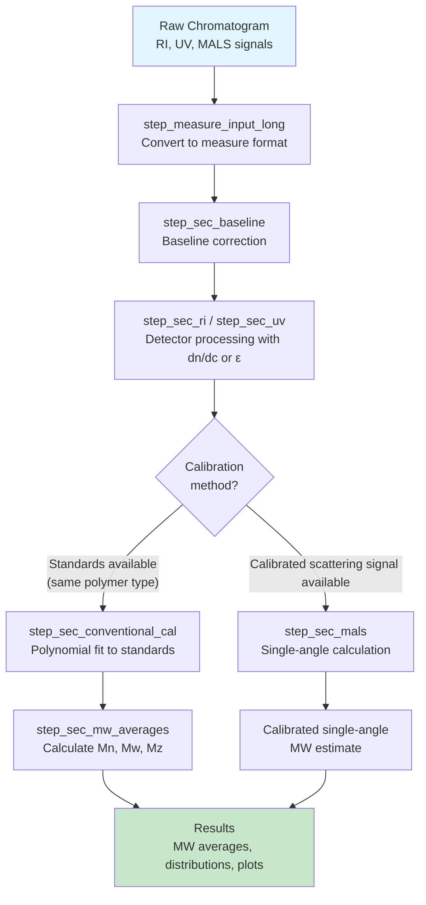

# Getting Started with measure.sec

## What you’ll learn

This tutorial shows how to:

1.  Convert detector data to the `measure` format
2.  Build and apply an SEC preprocessing recipe
3.  Add a conventional calibration from standards
4.  Calculate molecular weight averages and dispersity

## Prerequisites

You need basic familiarity with R, data frames, and pipes. The guide
introduces the SEC terms used in its examples.

## Overview

**measure.sec** provides preprocessing steps for Size Exclusion
Chromatography (SEC) and Gel Permeation Chromatography (GPC) data
analysis. It extends the
[measure](https://github.com/JamesHWade/measure) package using the
[recipes](https://recipes.tidymodels.org/) framework.

## What is SEC/GPC?

**Size Exclusion Chromatography (SEC)**, also called **Gel Permeation
Chromatography (GPC)**, separates molecules by hydrodynamic size. Larger
molecules generally elute earlier than smaller molecules. A conventional
calibration relates elution time or volume to molecular weight for the
standards used.

SEC chromatograms record detector response over an elution coordinate.
`measure.sec` provides recipe steps for processing RI, UV, and
light-scattering signals. Its scattering calculation is single-angle; a
molecular weight estimate requires suitable concentration units and a
detector calibration constant.

## Workflow overview

The diagram summarizes the conventional recipe; the separate scattering
branch uses the calibrated single-angle inputs described above.



## Installation

``` r

# Install from GitHub
# install.packages("pak")
pak::pak("JamesHWade/measure")
pak::pak("JamesHWade/measure.sec")
```

## Setup

``` r

library(measure)
#> Loading required package: recipes
#> Loading required package: dplyr
#> 
#> Attaching package: 'dplyr'
#> The following objects are masked from 'package:stats':
#> 
#>     filter, lag
#> The following objects are masked from 'package:base':
#> 
#>     intersect, setdiff, setequal, union
#> 
#> Attaching package: 'recipes'
#> The following object is masked from 'package:stats':
#> 
#>     step
library(measure.sec)
library(recipes)
library(dplyr)
library(ggplot2)
```

## The data model

SEC data in measure.sec uses the **measure** package’s nested tibble
structure. Understanding this structure is key to working effectively
with the package.

### `measure_tbl`: one chromatogram

A **`measure_tbl`** is a tibble (data frame) representing a single
chromatogram with two required columns:

- **`location`**: The x-axis values—typically elution time (minutes) or
  elution volume (mL)
- **`value`**: The detector response, in the source or processed units
  supplied by the workflow

Think of it as one line on a chromatogram plot. For example, an RI
detector signal from one injection is stored as a `measure_tbl`.

### `measure_list`: multiple chromatograms

A **`measure_list`** is a list column containing multiple `measure_tbl`
objects. This is the **internal format** used by measure.sec recipe
steps—you typically won’t create this yourself. Instead,
[`step_measure_input_long()`](https://jameshwade.github.io/measure/reference/step_measure_input_long.html)
converts your raw data into this format automatically.

After conversion, each sample row contains a list-column entry with one
`measure_tbl`. This schematic shows the structure; its placeholders are
not example measurements:

    sample_id     dn_dc       ri
    <sample_id>   <metadata>  <measure_list[1]>
                                └─ location | value
                                   <x value> | <response>
                                   <x value> | <response>

This nested structure has several advantages:

1.  **Tidy organization**: Each row is one sample with all its metadata
    and chromatogram(s)
2.  **Batch processing**: Apply the same recipe to many samples at once
3.  **Multiple detectors**: Store RI, UV, and MALS signals as separate
    nested columns
4.  **Metadata preservation**: Sample properties like `dn_dc` or
    `known_mw` travel with the chromatogram

## Example dataset

The package includes `sec_triple_detect`, a synthetic multi-detector SEC
dataset in **long format** (one row per time point). Its `elution_time`
field is in minutes. Use it to follow the workflow; it is not instrument
data.

``` r

# Load the example dataset
data(sec_triple_detect, package = "measure.sec")

# View the structure - this is LONG format data (one row per time point)
# The signal columns (ri_signal, uv_signal, mals_signal) are numeric vectors
glimpse(sec_triple_detect)
#> Rows: 24,012
#> Columns: 11
#> $ sample_id        <chr> "PS-1K", "PS-1K", "PS-1K", "PS-1K", "PS-1K", "PS-1K",…
#> $ sample_type      <chr> "standard", "standard", "standard", "standard", "stan…
#> $ polymer_type     <chr> "polystyrene", "polystyrene", "polystyrene", "polysty…
#> $ elution_time     <dbl> 5.00, 5.01, 5.02, 5.03, 5.04, 5.05, 5.06, 5.07, 5.08,…
#> $ ri_signal        <dbl> 6.926392e-04, 0.000000e+00, 3.199253e-04, 4.197175e-0…
#> $ uv_signal        <dbl> 0.0002034583, 0.0000000000, 0.0000000000, 0.000000000…
#> $ mals_signal      <dbl> 3.370385e-05, 3.483481e-05, 3.102092e-05, 3.261962e-0…
#> $ known_mw         <dbl> 1000, 1000, 1000, 1000, 1000, 1000, 1000, 1000, 1000,…
#> $ known_dispersity <dbl> 1.05, 1.05, 1.05, 1.05, 1.05, 1.05, 1.05, 1.05, 1.05,…
#> $ dn_dc            <dbl> 0.185, 0.185, 0.185, 0.185, 0.185, 0.185, 0.185, 0.18…
#> $ extinction_coef  <dbl> 1.2, 1.2, 1.2, 1.2, 1.2, 1.2, 1.2, 1.2, 1.2, 1.2, 1.2…
```

The dataset contains:

- **12 polymer samples**: polystyrene (PS), PMMA, PEG, and copolymers
- **~2,000 time points per sample**: giving 24,012 total rows
- **Three detector signals**: RI, UV, and MALS (as numeric columns)
- **Supplied molecular weights** for these synthetic examples
- **Example optical constants** such as dn/dc and extinction
  coefficients; use values appropriate to your sample and method

``` r

# View the unique samples in the dataset
# Each sample_id represents one injection; the chromatogram spans many rows
sec_triple_detect |>
  distinct(sample_id, sample_type, polymer_type) |>
  print(n = 12)
#> # A tibble: 12 × 3
#>    sample_id sample_type polymer_type
#>    <chr>     <chr>       <chr>       
#>  1 PS-1K     standard    polystyrene 
#>  2 PS-10K    standard    polystyrene 
#>  3 PS-50K    standard    polystyrene 
#>  4 PS-100K   standard    polystyrene 
#>  5 PS-500K   standard    polystyrene 
#>  6 PMMA-Low  sample      pmma        
#>  7 PMMA-Med  sample      pmma        
#>  8 PMMA-High sample      pmma        
#>  9 PEG-5K    sample      peg         
#> 10 PEG-20K   sample      peg         
#> 11 Copoly-A  sample      copolymer   
#> 12 Copoly-B  sample      copolymer
```

## Basic workflow: RI detector analysis

The next example processes the synthetic `PS-50K` trace with the RI
detector.

``` r

# Select a single polystyrene standard for this example
# In practice, you'd often process many samples at once
ps_sample <- sec_triple_detect |>
  filter(sample_id == "PS-50K")

# View sample info - note this is still long format (many rows per sample)
ps_sample |>
  select(sample_id, polymer_type, known_mw, elution_time, ri_signal) |>
  head()
#> # A tibble: 6 × 5
#>   sample_id polymer_type known_mw elution_time ri_signal
#>   <chr>     <chr>           <dbl>        <dbl>     <dbl>
#> 1 PS-50K    polystyrene     50000         5     0       
#> 2 PS-50K    polystyrene     50000         5.01  0.000279
#> 3 PS-50K    polystyrene     50000         5.02  0       
#> 4 PS-50K    polystyrene     50000         5.03  0       
#> 5 PS-50K    polystyrene     50000         5.04  0.000842
#> 6 PS-50K    polystyrene     50000         5.05  0.000483
```

### Step 1: Create a Recipe

**Recipes** define a sequence of preprocessing steps. Think of a recipe
as a blueprint for your analysis—it describes *what* to do, but doesn’t
do it yet. This separation lets you define the workflow once and apply
it to many samples.

``` r

# Start a recipe with your data
# The formula specifies: predictor columns ~ grouping column
# sample_id identifies which rows belong to each chromatogram
rec <- recipe(
  ri_signal + elution_time + dn_dc ~ sample_id,
  data = ps_sample
) |>
  update_role(sample_id, new_role = "id") |>
  # Convert the ri_signal column to measure format
  # This step tells recipes how to interpret your chromatogram data
  step_measure_input_long(
    ri_signal,
    location = vars(elution_time),
    col_name = "ri"
  )
```

### Step 2: Add Preprocessing Steps

Chain additional steps using the pipe (`|>`). Each step transforms the
data in sequence:

``` r

rec <- recipe(
  ri_signal + elution_time + dn_dc ~ sample_id,
  data = ps_sample
) |>
  update_role(sample_id, new_role = "id") |>
  # First: convert raw signal to measure format
  step_measure_input_long(
    ri_signal,
    location = vars(elution_time),
    col_name = "ri"
  ) |>
  # Second: correct the baseline (removes drift and offset)
  step_sec_baseline(measures = "ri") |>
  # Third: process RI signal using the sample's dn/dc value
  # Dividing by dn/dc converts the RI signal to concentration-proportional units
  step_sec_ri(measures = "ri", dn_dc_column = "dn_dc")
```

### Step 3: Prep and Bake

Two functions execute your recipe:

- **[`prep()`](https://recipes.tidymodels.org/reference/prep.html)**:
  Learns any required parameters from the training data (like baseline
  fit coefficients)
- **[`bake()`](https://recipes.tidymodels.org/reference/bake.html)**:
  Applies the transformations to produce results

``` r

# Prep: Learn parameters from the data
prepped <- prep(rec)

# Bake: Apply transformations (new_data = NULL means use the training data)
result <- bake(prepped, new_data = NULL)

# View the processed data - ri contains the baseline-corrected,
# dn/dc-scaled RI response
result |>
  select(sample_id, ri)
#> # A tibble: 1 × 2
#>   sample_id          ri
#>   <chr>          <meas>
#> 1 PS-50K    [2,001 × 2]
```

The source data are synthetic and do not assign units to the detector
signal. The plot uses the same elution-time support before and after
processing; its panels have separate vertical scales because
[`step_sec_ri()`](https://jameshwade.github.io/measure.sec/reference/step_sec_ri.md)
also scales the response by `dn_dc`.

``` r

raw_signal <- ps_sample |>
  transmute(location = elution_time, value = ri_signal, stage = "Raw RI signal")

processed_signal <- result$ri[[1]] |>
  transmute(location, value, stage = "Processed RI response")

stopifnot(identical(raw_signal$location, processed_signal$location))

bind_rows(raw_signal, processed_signal) |>
  mutate(stage = factor(stage, levels = c("Raw RI signal", "Processed RI response"))) |>
  ggplot(aes(location, value)) +
  geom_line(color = "#2E86AB", linewidth = 0.45) +
  facet_wrap(vars(stage), ncol = 1, scales = "free_y") +
  labs(
    x = "Elution time (min)",
    y = "Signal value (dataset scale)"
  ) +
  theme_minimal(base_size = 11)
```


Synthetic PS-50K RI trace before and after baseline correction and dn/dc
scaling. Both panels use the same measured elution-time locations; their
vertical scales are independent, and the dataset does not specify signal
units.

> [`prep()`](https://recipes.tidymodels.org/reference/prep.html) learns
> step parameters from its training data.
> [`bake()`](https://recipes.tidymodels.org/reference/bake.html) applies
> the prepared recipe to new data.

## Molecular weight averages

The most common outputs from SEC analysis are **molecular weight
averages**: - **Mn (number-average)**: Emphasizes lower MW species -
**Mw (weight-average)**: Emphasizes higher MW species - **Mz
(z-average)**: Even more sensitive to high MW species - **Dispersity
(Mw/Mn)**: Measures breadth of the MW distribution (1.0 = monodisperse)

Use
[`step_sec_mw_averages()`](https://jameshwade.github.io/measure.sec/reference/step_sec_mw_averages.md)
to calculate these. After
[`step_sec_conventional_cal()`](https://jameshwade.github.io/measure.sec/reference/step_sec_conventional_cal.md),
it pairs the concentration trace with the calibrated MW curve; their
locations remain elution time or volume. Alternatively, an input trace
can already use log₁₀(MW) as its axis. See the Calibration section below
for the complete workflow.

## Calibration curves

Most SEC analysis requires **calibration** to convert retention time to
molecular weight. The most common approach uses **narrow
standards**—polymers with known molecular weights and low dispersity—to
build a calibration curve.

A light-scattering workflow can estimate molecular weight without
polymer standards when it has suitable concentration units and a
detector calibration constant.
[`step_sec_mals()`](https://jameshwade.github.io/measure.sec/reference/step_sec_mals.md)
currently uses one angle; it does not calculate Rg or perform angular
extrapolation.

``` r

# Load polystyrene narrow standards
# These are well-characterized polymers used to build the calibration curve
data(sec_ps_standards, package = "measure.sec")

# View the standards - each has a known peak molecular weight (Mp)
sec_ps_standards |>
  select(standard_name, mp, log_mp, retention_time) |>
  print(n = 8)
#> # A tibble: 16 × 4
#>   standard_name      mp log_mp retention_time
#>   <chr>           <dbl>  <dbl>          <dbl>
#> 1 PS-3150000    3150000   6.50           11.2
#> 2 PS-1870000    1870000   6.27           11.6
#> 3 PS-1090000    1090000   6.04           12.1
#> 4 PS-630000      630000   5.80           12.6
#> 5 PS-430000      430000   5.63           13.2
#> 6 PS-216000      216000   5.33           13.8
#> 7 PS-120000      120000   5.08           14.3
#> 8 PS-67500        67500   4.83           15.0
#> # ℹ 8 more rows

# Visualize the cubic calibration with the package plotting helper
plot_sec_calibration(sec_ps_standards) +
  labs(
    x = "Retention time (min)",
    y = expression(log[10](M[p] / Da)),
    title = "Synthetic polystyrene standards"
  ) +
  theme_minimal(base_size = 11)
```


Calibration plot returned by
[`plot_sec_calibration()`](https://jameshwade.github.io/measure.sec/reference/plot_sec_calibration.md)
for the supplied synthetic polystyrene standards. The cubic fit and
R-squared annotation summarize this example standard set; retention is
shown only across the supplied range.

Apply the calibration using
[`step_sec_conventional_cal()`](https://jameshwade.github.io/measure.sec/reference/step_sec_conventional_cal.md):

``` r

# Prepare standards in the format expected by the calibration step
# Needs columns: retention (time/volume) and log_mw
ps_cal <- sec_ps_standards |>
  select(retention = retention_time, log_mw = log_mp)

rec_cal <- recipe(
  ri_signal + elution_time + dn_dc ~ sample_id,
  data = ps_sample
) |>
  update_role(sample_id, new_role = "id") |>
  step_measure_input_long(
    ri_signal,
    location = vars(elution_time),
    col_name = "ri"
  ) |>
  step_sec_baseline(measures = "ri") |>
  # Apply conventional calibration using polystyrene standards
  # This creates a separate log10(MW) curve on the same elution axis
  # fit_type options: "linear", "quadratic", "cubic" (most common)
  step_sec_conventional_cal(
    standards = ps_cal,
    fit_type = "cubic"
  ) |>
  # Calculate MW averages from the calibrated chromatogram
  # The averages step pairs the original signal with the calibrated curve
  step_sec_mw_averages(integration_range = range(ps_cal$retention))

prepped_cal <- prep(rec_cal)
#> Warning: Standard at 12.58 has 14.4% MW deviation.
#> ℹ Consider removing outlier standards or using a different fit type.
#> Warning: 1037 points (51.8%) are outside calibration range.
#> ℹ Calibration range: 11.15 to 20.79
result_cal <- bake(prepped_cal, new_data = NULL)

# View molecular weight results
# New columns are added with mw_ prefix
result_cal |>
  select(sample_id, mw_mn, mw_mw, mw_mz, mw_dispersity)
#> # A tibble: 1 × 5
#>   sample_id mw_mn   mw_mw    mw_mz mw_dispersity
#>   <chr>     <dbl>   <dbl>    <dbl>         <dbl>
#> 1 PS-50K    1816. 205442. 1236629.          113.
```

> The example integrates only the portion within the standards’
> retention range. Signal outside that range is excluded, so the results
> may not represent whole-sample averages. Conventional calibration
> assumes sample and standard hydrodynamic behavior are comparable;
> choose standards or another calibration approach appropriate to the
> sample and method.

## Available steps

The package provides a comprehensive set of recipe steps. Here’s a quick
reference organized by function:

### Preprocessing

- [`step_sec_baseline()`](https://jameshwade.github.io/measure.sec/reference/step_sec_baseline.md):
  SEC-optimized baseline correction
- [`step_sec_detector_delay()`](https://jameshwade.github.io/measure.sec/reference/step_sec_detector_delay.md):
  Correct inter-detector delays

### Detector Processing

- [`step_sec_ri()`](https://jameshwade.github.io/measure.sec/reference/step_sec_ri.md):
  RI detector with dn/dc
- [`step_sec_uv()`](https://jameshwade.github.io/measure.sec/reference/step_sec_uv.md):
  UV detector with extinction coefficient
- [`step_sec_mals()`](https://jameshwade.github.io/measure.sec/reference/step_sec_mals.md),
  [`step_sec_lals()`](https://jameshwade.github.io/measure.sec/reference/step_sec_lals.md),
  [`step_sec_rals()`](https://jameshwade.github.io/measure.sec/reference/step_sec_rals.md):
  Light scattering
- [`step_sec_dls()`](https://jameshwade.github.io/measure.sec/reference/step_sec_dls.md):
  Dynamic light scattering
- [`step_sec_viscometer()`](https://jameshwade.github.io/measure.sec/reference/step_sec_viscometer.md):
  Differential viscometer

### Molecular Weight

- [`step_sec_mw_averages()`](https://jameshwade.github.io/measure.sec/reference/step_sec_mw_averages.md):
  Mn, Mw, Mz, dispersity
- [`step_sec_mw_fractions()`](https://jameshwade.github.io/measure.sec/reference/step_sec_mw_fractions.md):
  MW fractions above/below cutoffs
- [`step_sec_mw_distribution()`](https://jameshwade.github.io/measure.sec/reference/step_sec_mw_distribution.md):
  Differential/cumulative MWD
- [`step_sec_conventional_cal()`](https://jameshwade.github.io/measure.sec/reference/step_sec_conventional_cal.md):
  Narrow standard calibration
- [`step_sec_universal_cal()`](https://jameshwade.github.io/measure.sec/reference/step_sec_universal_cal.md):
  Universal calibration

### Composition & Protein

- [`step_sec_uv_ri_ratio()`](https://jameshwade.github.io/measure.sec/reference/step_sec_uv_ri_ratio.md):
  UV/RI ratio for heterogeneity
- [`step_sec_composition()`](https://jameshwade.github.io/measure.sec/reference/step_sec_composition.md):
  Copolymer composition
- [`step_sec_aggregates()`](https://jameshwade.github.io/measure.sec/reference/step_sec_aggregates.md):
  HMWS/monomer/LMWS quantitation
- [`step_sec_protein()`](https://jameshwade.github.io/measure.sec/reference/step_sec_protein.md):
  Complete protein SEC workflow

## Troubleshooting

**Common issues and quick fixes:**

| Problem | Solution |
|----|----|
| “Column not found” | Check column names match exactly (case-sensitive) |
| “No measure columns found” | Add [`step_measure_input_long()`](https://jameshwade.github.io/measure/reference/step_measure_input_long.html) at the start of your recipe |
| NA values in MW results | Check calibration range covers your retention times |
| Recipe won’t prep | Try prepping with fewer steps to isolate the issue |

``` r

# Debugging tips:
names(your_data)                    # Check column names
measure::find_measure_cols(result)  # Find measure columns after bake
result$ri[[1]] |> summary()         # Inspect chromatogram data
```

## Next steps

Now that you understand the basics, explore these vignettes for
specialized workflows:

| Vignette | Use when you need to… |
|----|----|
| [Multi-Detector SEC](https://jameshwade.github.io/measure.sec/articles/triple-detection.md) | Integrate multiple detectors (RI + UV + LS) |
| [MALS Detection](https://jameshwade.github.io/measure.sec/articles/mals-detection.md) | Configure and interpret the single-angle scattering step |
| [LALS/RALS Detection](https://jameshwade.github.io/measure.sec/articles/lals-rals-detection.md) | Use single-angle light scattering |
| [Protein SEC](https://jameshwade.github.io/measure.sec/articles/protein-sec.md) | Analyze aggregates (HMWS/monomer/LMWS) |
| [Copolymer Composition](https://jameshwade.github.io/measure.sec/articles/copolymer-analysis.md) | Determine composition via UV/RI ratio |
| [Calibration Management](https://jameshwade.github.io/measure.sec/articles/calibration-management.md) | Save, load, and reuse calibrations |
| [System Suitability](https://jameshwade.github.io/measure.sec/articles/system-suitability.md) | Set up QC checks and column monitoring |
| [Exporting Results](https://jameshwade.github.io/measure.sec/articles/exporting-results.md) | Generate summary tables and reports |

You can also browse all available functions with:

``` r

# See all SEC/GPC steps registered with measure
measure::measure_steps(techniques = "SEC/GPC")
```

## Session information

``` r

sessionInfo()
#> R version 4.6.2 (2026-10-29)
#> Platform: x86_64-pc-linux-gnu
#> Running under: Ubuntu 26.04.1 LTS
#> 
#> Matrix products: default
#> BLAS:   /usr/lib/x86_64-linux-gnu/openblas-pthread/libblas.so.3 
#> LAPACK: /usr/lib/x86_64-linux-gnu/openblas-pthread/libopenblasp-r0.3.32.so;  LAPACK version 3.12.0
#> 
#> locale:
#>  [1] LC_CTYPE=C.UTF-8       LC_NUMERIC=C           LC_TIME=C.UTF-8       
#>  [4] LC_COLLATE=C.UTF-8     LC_MONETARY=C.UTF-8    LC_MESSAGES=C.UTF-8   
#>  [7] LC_PAPER=C.UTF-8       LC_NAME=C              LC_ADDRESS=C          
#> [10] LC_TELEPHONE=C         LC_MEASUREMENT=C.UTF-8 LC_IDENTIFICATION=C   
#> 
#> time zone: UTC
#> tzcode source: system (glibc)
#> 
#> attached base packages:
#> [1] stats     graphics  grDevices utils     datasets  methods   base     
#> 
#> other attached packages:
#> [1] ggplot2_4.0.4          measure.sec_0.0.0.9000 measure_0.0.1.9004    
#> [4] recipes_1.4.0          dplyr_1.2.1           
#> 
#> loaded via a namespace (and not attached):
#>  [1] gtable_0.3.6        xfun_0.62           bslib_0.12.0       
#>  [4] lattice_0.23-1      vctrs_0.7.3         tools_4.6.2        
#>  [7] generics_0.1.4      parallel_4.6.2      tibble_3.3.1       
#> [10] pkgconfig_2.0.3     Matrix_1.7-6        data.table_1.18.6.1
#> [13] RColorBrewer_1.1-3  S7_0.2.2            desc_1.4.3         
#> [16] lifecycle_1.0.5     compiler_4.6.2      farver_2.1.2       
#> [19] textshaping_1.0.5   codetools_0.2-20    htmltools_0.5.9    
#> [22] class_7.3-24        sass_0.4.10         yaml_2.3.12        
#> [25] prodlim_2026.03.11  tidyr_1.3.2         pillar_1.11.1      
#> [28] pkgdown_2.2.1       jquerylib_0.1.4     MASS_7.3-66        
#> [31] cachem_1.1.0        gower_1.0.2         rpart_4.1.27       
#> [34] parallelly_1.50.0   lava_1.11           tidyselect_1.2.1   
#> [37] digest_0.6.39       future_1.82.0       purrr_1.2.2        
#> [40] listenv_1.1.0       labeling_0.4.3      splines_4.6.2      
#> [43] fastmap_1.2.0       grid_4.6.2          cli_3.6.6          
#> [46] magrittr_2.0.5      utf8_1.2.6          survival_3.8-12    
#> [49] future.apply_1.21.0 withr_3.0.3         scales_1.4.0       
#> [52] lubridate_1.9.5     timechange_0.4.0    rmarkdown_2.32     
#> [55] globals_0.20.0      otel_0.3.0          nnet_7.3-21        
#> [58] timeDate_4052.112   ragg_1.5.2          evaluate_1.0.5     
#> [61] knitr_1.52          hardhat_1.4.3       rlang_1.3.0        
#> [64] Rcpp_1.1.2          glue_1.8.1          ipred_0.9-16       
#> [67] jsonlite_2.0.0      R6_2.6.1            systemfonts_1.3.3  
#> [70] fs_2.1.0
```
