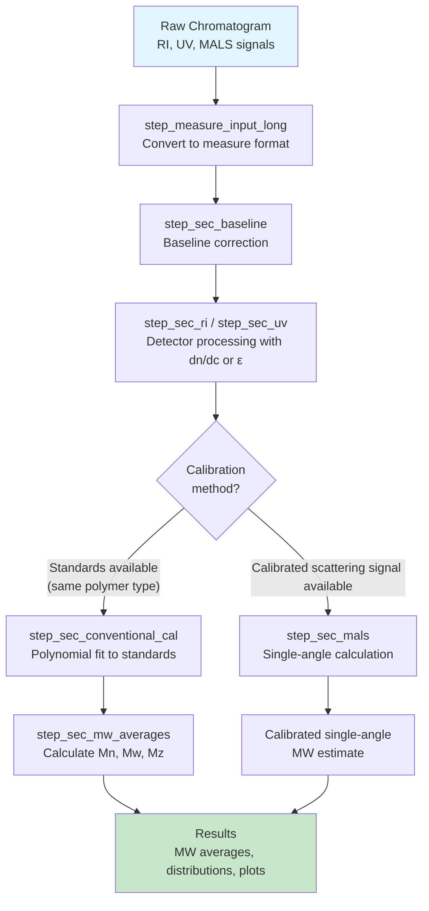

```{r, include = FALSE}
knitr::opts_chunk$set(
  collapse = TRUE,
  comment = "#>",
  fig.width = 7,
  fig.height = 4.5
)
```

## What you'll learn

This tutorial shows how to:

1. Convert detector data to the `measure` format
2. Build and apply an SEC preprocessing recipe
3. Add a conventional calibration from standards
4. Calculate molecular weight averages and dispersity

## Prerequisites

You need basic familiarity with R, data frames, and pipes. The guide introduces the SEC terms used in its examples.

## Overview

**measure.sec** provides preprocessing steps for Size Exclusion Chromatography (SEC) and Gel Permeation Chromatography (GPC) data analysis. It extends the [measure](https://github.com/JamesHWade/measure) package using the [recipes](https://recipes.tidymodels.org/) framework.

## What is SEC/GPC?

**Size Exclusion Chromatography (SEC)**, also called **Gel Permeation Chromatography (GPC)**, separates molecules by hydrodynamic size. Larger molecules generally elute earlier than smaller molecules. A conventional calibration relates elution time or volume to molecular weight for the standards used.

SEC chromatograms record detector response over an elution coordinate. `measure.sec` provides recipe steps for processing RI, UV, and light-scattering signals. Its scattering calculation is single-angle; a molecular weight estimate requires suitable concentration units and a detector calibration constant.

## Workflow overview

The diagram summarizes the conventional recipe; the separate scattering branch uses the calibrated single-angle inputs described above.



## Installation

```{r install, eval = FALSE}
# Install from GitHub
# install.packages("pak")
pak::pak("JamesHWade/measure")
pak::pak("JamesHWade/measure.sec")
```

## Setup

```{r setup}
library(measure)
library(measure.sec)
library(recipes)
library(dplyr)
library(ggplot2)
```

## The data model

SEC data in measure.sec uses the **measure** package's nested tibble structure. Understanding this structure is key to working effectively with the package.

### `measure_tbl`: one chromatogram

A **`measure_tbl`** is a tibble (data frame) representing a single chromatogram with two required columns:

- **`location`**: The x-axis values—typically elution time (minutes) or elution volume (mL)
- **`value`**: The detector response, in the source or processed units supplied by the workflow

Think of it as one line on a chromatogram plot. For example, an RI detector signal from one injection is stored as a `measure_tbl`.

### `measure_list`: multiple chromatograms

A **`measure_list`** is a list column containing multiple `measure_tbl` objects. This is the **internal format** used by measure.sec recipe steps—you typically won't create this yourself. Instead, `step_measure_input_long()` converts your raw data into this format automatically.

After conversion, each sample row contains a list-column entry with one `measure_tbl`. This schematic shows the structure; its placeholders are not example measurements:

```
sample_id     dn_dc       ri
<sample_id>   <metadata>  <measure_list[1]>
                            └─ location | value
                               <x value> | <response>
                               <x value> | <response>
```

This nested structure has several advantages:

1. **Tidy organization**: Each row is one sample with all its metadata and chromatogram(s)
2. **Batch processing**: Apply the same recipe to many samples at once
3. **Multiple detectors**: Store RI, UV, and MALS signals as separate nested columns
4. **Metadata preservation**: Sample properties like `dn_dc` or `known_mw` travel with the chromatogram

## Example dataset

The package includes `sec_triple_detect`, a synthetic multi-detector SEC dataset in **long format** (one row per time point). Its `elution_time` field is in minutes. Use it to follow the workflow; it is not instrument data.

```{r data}
# Load the example dataset
data(sec_triple_detect, package = "measure.sec")

# View the structure - this is LONG format data (one row per time point)
# The signal columns (ri_signal, uv_signal, mals_signal) are numeric vectors
glimpse(sec_triple_detect)
```

The dataset contains:

- **12 polymer samples**: polystyrene (PS), PMMA, PEG, and copolymers
- **~2,000 time points per sample**: giving 24,012 total rows
- **Three detector signals**: RI, UV, and MALS (as numeric columns)
- **Supplied molecular weights** for these synthetic examples
- **Example optical constants** such as dn/dc and extinction coefficients; use values appropriate to your sample and method

```{r samples}
# View the unique samples in the dataset
# Each sample_id represents one injection; the chromatogram spans many rows
sec_triple_detect |>
  distinct(sample_id, sample_type, polymer_type) |>
  print(n = 12)
```

## Basic workflow: RI detector analysis

The next example processes the synthetic `PS-50K` trace with the RI detector.

```{r basic-workflow}
# Select a single polystyrene standard for this example
# In practice, you'd often process many samples at once
ps_sample <- sec_triple_detect |>
  filter(sample_id == "PS-50K")

# View sample info - note this is still long format (many rows per sample)
ps_sample |>
  select(sample_id, polymer_type, known_mw, elution_time, ri_signal) |>
  head()
```

### Step 1: Create a Recipe

**Recipes** define a sequence of preprocessing steps. Think of a recipe as a blueprint for your analysis—it describes *what* to do, but doesn't do it yet. This separation lets you define the workflow once and apply it to many samples.

```{r recipe}
# Start a recipe with your data
# The formula specifies: predictor columns ~ grouping column
# sample_id identifies which rows belong to each chromatogram
rec <- recipe(
  ri_signal + elution_time + dn_dc ~ sample_id,
  data = ps_sample
) |>
  update_role(sample_id, new_role = "id") |>
  # Convert the ri_signal column to measure format
  # This step tells recipes how to interpret your chromatogram data
  step_measure_input_long(
    ri_signal,
    location = vars(elution_time),
    col_name = "ri"
  )
```

### Step 2: Add Preprocessing Steps

Chain additional steps using the pipe (`|>`). Each step transforms the data in sequence:

```{r preprocess}
rec <- recipe(
  ri_signal + elution_time + dn_dc ~ sample_id,
  data = ps_sample
) |>
  update_role(sample_id, new_role = "id") |>
  # First: convert raw signal to measure format
  step_measure_input_long(
    ri_signal,
    location = vars(elution_time),
    col_name = "ri"
  ) |>
  # Second: correct the baseline (removes drift and offset)
  step_sec_baseline(measures = "ri") |>
  # Third: process RI signal using the sample's dn/dc value
  # Dividing by dn/dc converts the RI signal to concentration-proportional units
  step_sec_ri(measures = "ri", dn_dc_column = "dn_dc")
```

### Step 3: Prep and Bake

Two functions execute your recipe:

- **`prep()`**: Learns any required parameters from the training data (like baseline fit coefficients)
- **`bake()`**: Applies the transformations to produce results

```{r prep-bake}
# Prep: Learn parameters from the data
prepped <- prep(rec)

# Bake: Apply transformations (new_data = NULL means use the training data)
result <- bake(prepped, new_data = NULL)

# View the processed data - ri contains the baseline-corrected,
# dn/dc-scaled RI response
result |>
  select(sample_id, ri)
```

The source data are synthetic and do not assign units to the detector signal. The plot uses the same elution-time support before and after processing; its panels have separate vertical scales because `step_sec_ri()` also scales the response by `dn_dc`.

```{r signal-before-after, fig.cap="Synthetic PS-50K RI trace before and after baseline correction and dn/dc scaling. Both panels use the same measured elution-time locations; their vertical scales are independent, and the dataset does not specify signal units.", fig.alt="Two-panel faceted line chart of synthetic PS-50K RI response. Elution time in minutes is on the horizontal axis and signal value on the vertical axis. The first panel shows the input RI signal; the second shows the response after baseline correction and dn/dc scaling. Both panels use the same measured locations and separate vertical ranges."}
raw_signal <- ps_sample |>
  transmute(location = elution_time, value = ri_signal, stage = "Raw RI signal")

processed_signal <- result$ri[[1]] |>
  transmute(location, value, stage = "Processed RI response")

stopifnot(identical(raw_signal$location, processed_signal$location))

bind_rows(raw_signal, processed_signal) |>
  mutate(stage = factor(stage, levels = c("Raw RI signal", "Processed RI response"))) |>
  ggplot(aes(location, value)) +
  geom_line(color = "#2E86AB", linewidth = 0.45) +
  facet_wrap(vars(stage), ncol = 1, scales = "free_y") +
  labs(
    x = "Elution time (min)",
    y = "Signal value (dataset scale)"
  ) +
  theme_minimal(base_size = 11)
```

> `prep()` learns step parameters from its training data. `bake()` applies the prepared recipe to new data.


## Molecular weight averages

The most common outputs from SEC analysis are **molecular weight averages**:
- **Mn (number-average)**: Emphasizes lower MW species
- **Mw (weight-average)**: Emphasizes higher MW species
- **Mz (z-average)**: Even more sensitive to high MW species
- **Dispersity (Mw/Mn)**: Measures breadth of the MW distribution (1.0 = monodisperse)

Use `step_sec_mw_averages()` to calculate these. After `step_sec_conventional_cal()`, it pairs the concentration trace with the calibrated MW curve; their locations remain elution time or volume. Alternatively, an input trace can already use log₁₀(MW) as its axis. See the Calibration section below for the complete workflow.

## Calibration curves

Most SEC analysis requires **calibration** to convert retention time to molecular weight. The most common approach uses **narrow standards**—polymers with known molecular weights and low dispersity—to build a calibration curve.

A light-scattering workflow can estimate molecular weight without polymer standards when it has suitable concentration units and a detector calibration constant. `step_sec_mals()` currently uses one angle; it does not calculate Rg or perform angular extrapolation.

```{r calibration, fig.width=7, fig.height=4.5, fig.cap="Calibration plot returned by `plot_sec_calibration()` for the supplied synthetic polystyrene standards. The cubic fit and R-squared annotation summarize this example standard set; retention is shown only across the supplied range.", fig.alt="Calibration chart for the synthetic polystyrene standards, produced by `plot_sec_calibration()`. Retention time in minutes is on the horizontal axis and log10 peak molecular weight in daltons is on the vertical axis. Points mark the supplied standards; a fitted cubic curve decreases across their observed retention range, with the plotted R-squared annotation describing this synthetic fit."}
# Load polystyrene narrow standards
# These are well-characterized polymers used to build the calibration curve
data(sec_ps_standards, package = "measure.sec")

# View the standards - each has a known peak molecular weight (Mp)
sec_ps_standards |>
  select(standard_name, mp, log_mp, retention_time) |>
  print(n = 8)

# Visualize the cubic calibration with the package plotting helper
plot_sec_calibration(sec_ps_standards) +
  labs(
    x = "Retention time (min)",
    y = expression(log[10](M[p] / Da)),
    title = "Synthetic polystyrene standards"
  ) +
  theme_minimal(base_size = 11)
```

Apply the calibration using `step_sec_conventional_cal()`:

```{r conventional-cal}
# Prepare standards in the format expected by the calibration step
# Needs columns: retention (time/volume) and log_mw
ps_cal <- sec_ps_standards |>
  select(retention = retention_time, log_mw = log_mp)

rec_cal <- recipe(
  ri_signal + elution_time + dn_dc ~ sample_id,
  data = ps_sample
) |>
  update_role(sample_id, new_role = "id") |>
  step_measure_input_long(
    ri_signal,
    location = vars(elution_time),
    col_name = "ri"
  ) |>
  step_sec_baseline(measures = "ri") |>
  # Apply conventional calibration using polystyrene standards
  # This creates a separate log10(MW) curve on the same elution axis
  # fit_type options: "linear", "quadratic", "cubic" (most common)
  step_sec_conventional_cal(
    standards = ps_cal,
    fit_type = "cubic"
  ) |>
  # Calculate MW averages from the calibrated chromatogram
  # The averages step pairs the original signal with the calibrated curve
  step_sec_mw_averages(integration_range = range(ps_cal$retention))

prepped_cal <- prep(rec_cal)
result_cal <- bake(prepped_cal, new_data = NULL)

# View molecular weight results
# New columns are added with mw_ prefix
result_cal |>
  select(sample_id, mw_mn, mw_mw, mw_mz, mw_dispersity)
```

> The example integrates only the portion within the standards’ retention range. Signal outside that range is excluded, so the results may not represent whole-sample averages. Conventional calibration assumes sample and standard hydrodynamic behavior are comparable; choose standards or another calibration approach appropriate to the sample and method.


## Available steps

The package provides a comprehensive set of recipe steps. Here's a quick reference organized by function:

### Preprocessing
- `step_sec_baseline()`: SEC-optimized baseline correction
- `step_sec_detector_delay()`: Correct inter-detector delays

### Detector Processing
- `step_sec_ri()`: RI detector with dn/dc
- `step_sec_uv()`: UV detector with extinction coefficient
- `step_sec_mals()`, `step_sec_lals()`, `step_sec_rals()`: Light scattering
- `step_sec_dls()`: Dynamic light scattering
- `step_sec_viscometer()`: Differential viscometer

### Molecular Weight
- `step_sec_mw_averages()`: Mn, Mw, Mz, dispersity
- `step_sec_mw_fractions()`: MW fractions above/below cutoffs
- `step_sec_mw_distribution()`: Differential/cumulative MWD
- `step_sec_conventional_cal()`: Narrow standard calibration
- `step_sec_universal_cal()`: Universal calibration

### Composition & Protein
- `step_sec_uv_ri_ratio()`: UV/RI ratio for heterogeneity
- `step_sec_composition()`: Copolymer composition
- `step_sec_aggregates()`: HMWS/monomer/LMWS quantitation
- `step_sec_protein()`: Complete protein SEC workflow

## Troubleshooting

**Common issues and quick fixes:**

| Problem | Solution |
|---------|----------|
| "Column not found" | Check column names match exactly (case-sensitive) |
| "No measure columns found" | Add `step_measure_input_long()` at the start of your recipe |
| NA values in MW results | Check calibration range covers your retention times |
| Recipe won't prep | Try prepping with fewer steps to isolate the issue |

```{r troubleshoot, eval = FALSE}
# Debugging tips:
names(your_data)                    # Check column names
measure::find_measure_cols(result)  # Find measure columns after bake
result$ri[[1]] |> summary()         # Inspect chromatogram data
```

## Next steps

Now that you understand the basics, explore these vignettes for specialized workflows:

| Vignette | Use when you need to... |
|----------|------------------------|
| [Multi-Detector SEC](triple-detection.html) | Integrate multiple detectors (RI + UV + LS) |
| [MALS Detection](mals-detection.html) | Configure and interpret the single-angle scattering step |
| [LALS/RALS Detection](lals-rals-detection.html) | Use single-angle light scattering |
| [Protein SEC](protein-sec.html) | Analyze aggregates (HMWS/monomer/LMWS) |
| [Copolymer Composition](copolymer-analysis.html) | Determine composition via UV/RI ratio |
| [Calibration Management](calibration-management.html) | Save, load, and reuse calibrations |
| [System Suitability](system-suitability.html) | Set up QC checks and column monitoring |
| [Exporting Results](exporting-results.html) | Generate summary tables and reports |

You can also browse all available functions with:

```{r list-steps, eval = FALSE}
# See all SEC/GPC steps registered with measure
measure::measure_steps(techniques = "SEC/GPC")
```

## Session information

```{r session-info}
sessionInfo()
```
